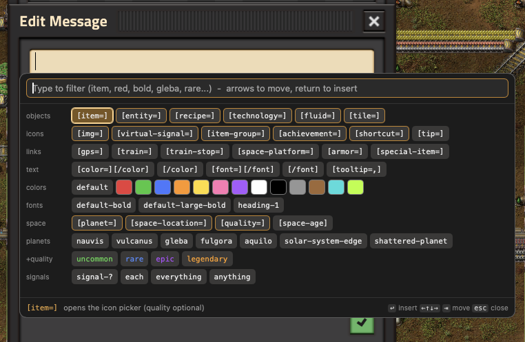
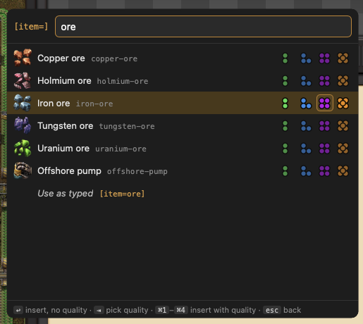

# Factorio Rich Text for BetterTouchTool

A small floating menu for macOS that inserts Factorio [rich text tags](https://wiki.factorio.com/Rich_text) (`[item=…]`, `[color=…]`, `[gps=…]`, `[planet=…]`…) into the chat or any text box. A searchable icon picker covers items, entities, recipes, signals and more, with optional quality. Everything works from the keyboard.

## Install

1. Quit Factorio and run [`factorio-richtext-setup.sh`](factorio-richtext-setup.sh) once: `bash factorio-richtext-setup.sh`.
   It uses the game's own `--dump-prototype-locale` and `--dump-icon-sprites` options to export names and icons, mods included. Run it again after you change mods or the game language.
2. In [BetterTouchTool](https://folivora.ai), go to **Presets → Import** and choose [`Factorio-Rich-Text.bttpreset`](Factorio-Rich-Text.bttpreset).

## Use

- **⌃⌥⌘R** opens the menu at the mouse. Type to filter, use ←↑↓→ or ⇥ to move, **↩** to insert and **esc** to close.
- Orange buttons open the icon picker. **↩** inserts without quality, **⇥** or **⌘1–⌘4** adds a quality, and **esc** goes back.

To uninstall, delete the "Factorio Rich Text" preset in BTT's Presets window.

## Links

- [Factorio wiki: Rich text](https://wiki.factorio.com/Rich_text)
- [BetterTouchTool docs](https://docs.folivora.ai)
